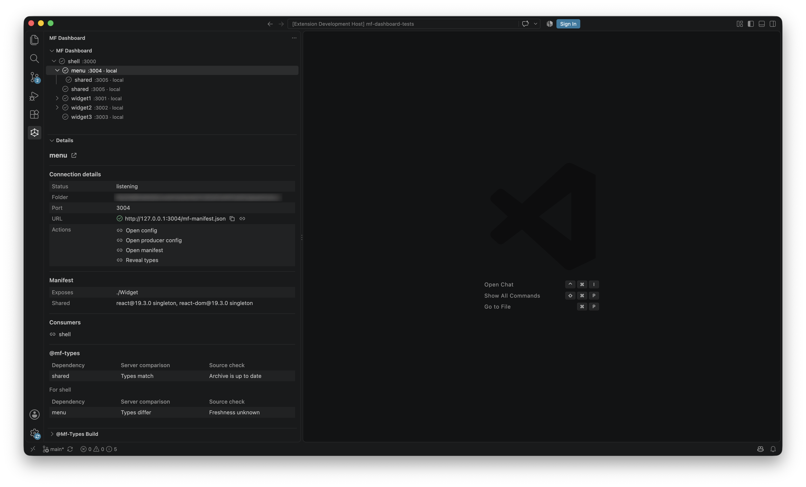

# MF Dashboard

[English](README.md) | [Русский](README.ru.md)

MF Dashboard is a VS Code extension for working with Module Federation microfrontends. From the MF Dashboard panel, you can monitor applications and their remote dependencies, start local applications, update types, and open configurations and manifests.



## Installation

1. `.vsix`: install from [GitHub Releases](https://github.com/megahoma/mf-dashboard/releases).

## Features

1. **Local graph** of discovered microfrontend configurations.
2. **Work with multiple projects** in one VS Code window.
3. **Tree or flat list** of microfrontends. In the flat list, use **View & Sort** to sort by name or port. The selected sort is checked and saved for the workspace.
4. **Periodic checks** of ports, manifests, and types ZIP archives.
5. **Availability checks** for external manifests.
6. **Start local applications** through `package.json` scripts.
7. **Update and rebuild types**: download consumer `@mf-types` and generate types for local producers.
8. **Navigation from Details or the context menu** to configurations, the types directory, and the JSON manifest.
9. **URL and types diagnostics in Problems** with links to the consumer configuration or workspace settings.

### Statuses and diagnostics

| Status                      | Meaning                                                                          |
| --------------------------- | -------------------------------------------------------------------------------- |
| `listening`                 | The local app's port is open.                                                    |
| `stopped`                   | The local port is closed.                                                        |
| `port unknown`              | No local port could be resolved from the configuration.                          |
| `types not rebuilt`         | Producer sources are newer than the types ZIP and the settle period has elapsed. |
| `types not updated`         | The consumer's types are missing or do not match the remote ZIP.                 |
| `URL error`                 | The URL is empty, has unresolved variables, or is not HTTP(S).                   |
| `non-local URL`             | A link to a local app points to another host.                                    |
| `different port`            | The link URL points to a different port.                                         |
| `reachable` / `unreachable` | An external manifest answered or failed to answer.                               |

The tree shows the local port and connection status. Selecting a microfrontend updates **Details**. If the section is collapsed, expand it manually. You can see the manifest's availability, copy its URL, and open the manifest preview once it responds. **Consumers** lists all detected microfrontends that directly depend on the selected one. Select a consumer to see its details.

The **@mf-types** section at the bottom shows two checks for each dependency. **Server comparison** tells you whether the installed types match the ZIP served by the remote. **Source check** tells you whether the ZIP is current with the local producer's sources. If the local microfrontend is stopped, the panel prompts you to start it. Disabling a producer's `generateTypes` disables its source check and rebuild. Consumer types can still be checked, and **Fetch @mf-types** works while the consumer is stopped.

**Update @mf-types across the workspace** opens **@mf-types Build** and runs the workspace build. To rebuild a single microfrontend, use its row action. This prepares its dependencies and rebuilds its own types where applicable. Use the workspace action to also install updated types in its consumers. If the remote manifest is unavailable, the build can use a freshly built ZIP from a unique local producer with the same name. Rows show progress and errors, and independent builds continue after a failure. **Show results from the last @mf-types update** opens the latest report for this workspace.

URL issues and unreachable external manifests appear as warnings in Problems. Types issues appear as information. Build errors with a known source file also appear in Problems.

## Detection

**Find microfrontends** scans for these config files:

| Config family     | File name                    |
| ----------------- | ---------------------------- |
| Module Federation | `module-federation.config.*` |
| Webpack           | `webpack.config.*`           |
| Rspack            | `rspack.config.*`            |
| Rsbuild           | `rsbuild.config.*`           |
| Rslib             | `rslib.config.*`             |
| Vite              | `vite.config.*`              |

Supported extensions are `.mjs`, `.cjs`, `.js`, `.mts`, `.cts`, `.ts`, `.jsx`, and `.tsx`. Discovery uses Babel to read source without executing the config. It recognizes `pluginModuleFederation`, `ModuleFederationPlugin`, and `createModuleFederationConfig`, constants, aliases, object spreads, static expressions, and synchronous helpers with statically known `if` and `switch` branches. Relative named/default/namespace imports, local JSON, and local re-exports are supported within the same package. The project's TypeScript version does not affect discovery. Async helpers, dynamic imports, package helpers, and tsconfig path aliases remain unresolved.

Discovery uses the dev context for Rsbuild and Vite config functions. It reads literal environment assignments from a simple start script, including scripts prefixed with `cross-env`. It can statically read a selected `.env` file in the config directory through `dotenv.parse`.

For Rslib, discovery reads one statically resolvable `format: 'mf'` profile, using `NODE_ENV=development` by default. It reads the profile's federation plugin and merges the relevant settings with the top-level config. When the plugin omits `dts`, types are enabled if the library has a `tsconfig.json`. Use `scripts.start` to select the project's `rslib mf-dev` script if it has a custom name.

When discovery follows an Rslib launcher, it loads dotenv files from the selected config's package if that package contains the launcher or is a project below the launcher's directory.
Reads tied to a verified config directory use a local helper. On Windows the helper uses Windows PowerShell. If system policy blocks the helper, the affected dotenv reads are skipped.

A simple start script can select a config with `--config`. Discovery uses `mf-dashboard.scripts.start`, which new app entries inherit. Set `configFile` on an app entry to select a file explicitly. The path is relative to the app folder and takes precedence over the script.

The local port comes from `server.port` or `devServer.port`. Remote URLs may use `process.env` or `import.meta.env` values from `.env.<mode>` and `.env.<mode>.local`, with the local file taking precedence. When discovery recognizes a Vite start script, it resolves `process.env` from literal assignments in the script and uses Vite's default `NODE_ENV` when the script leaves it unset. The default manifest path is `/mf-manifest.json`.

After cloning, run **Find microfrontends** once. It generates `.mf-dashboard/graph.json` and adds an ignore rule in `.mf-dashboard/.gitignore`. The graph is a local cache. On later opens, the dashboard renders the saved graph while probes run. **Refresh** updates statuses using the graph. **Find microfrontends** is available in the toolbar to rebuild it.

The graph stores relative paths, resolved URLs and checksums of relevant inputs, including local dotenv files. A dotenv edit marks the existing tree as outdated until the next Find. Explicit types rebuilds read the current build configs and launcher environment.

Discovery skips `node_modules`, `.git`, `dist`, `.mf-dashboard`, and `mf-dashboard.ignorePaths`. It writes one graph per workspace folder. Federation names and workspace-folder names must be unique. A conflicting search preserves the saved graph. The dashboard marks an outdated graph when it detects changes to discovery settings, tracked inputs, or candidate files, including custom configs selected by the start script.

Probe cycles share manifest requests and ZIP downloads by URL. Later cycles use `If-Modified-Since` when available and reuse ZIP hashes on 304.

When you check `@mf-types`, the extension compares types installed by Rsbuild in watch mode or by another tool against the published ZIP. Run **Refresh** or **Check @mf-types** to check manually, or set `mf-dashboard.types.autoCheck` to `true` for automatic checks. The comparison may download the archive again when its hash or the installed files change. It records a match as a confirmed installation, reuses unchanged results and leaves the consumer's type files intact.

Producer sources follow `files`, `include`, `exclude`, and inherited settings from the selected tsconfig. Explicit `files` entries are included even with an empty `include`. Declaration files, downloaded types, output directories, and files outside the app or reached through symlinks are omitted. An unreadable or invalid tsconfig leaves the type estimate unknown.

With automatic type checks enabled, saving an included `.ts` or `.tsx` source in VS Code refreshes the local types estimate immediately and after `typesSettleMs`. The save check uses local files and archive comparisons already in memory. Periodic probes also cover changes outside the editor. Cache entries use file size and mtime, so an edit preserving both may leave the previous result cached.

## Supported package versions

| Package                             | Version / scope                                |
| ----------------------------------- | ---------------------------------------------- |
| VS Code                             | `^1.90.0`, required by the extension manifest. |
| `@module-federation/enhanced`       | `2.9.1`                                        |
| `@module-federation/rsbuild-plugin` | `2.9.1`                                        |

Built-in type generation uses the Module Federation API through project-local packages. For Rsbuild it loads the config and captures plugin options. For Rslib it reads the MF profile statically and passes its options to the same generator. Detection alone does not guarantee built-in type generation for other bundlers.

Package versions are not checked against a semver matrix at runtime. Compatibility with other versions is not established. If built-in generation cannot use your config or plugin API, set `mf-dashboard.commands.rebuildTypes` to your project's generation command. Discovery itself does not require these packages to be loaded.

## Settings

All settings use the `mf-dashboard.*` namespace.

| Setting                              | Default       | Description                                                                                                                                                                                                                  |
| ------------------------------------ | ------------- | ---------------------------------------------------------------------------------------------------------------------------------------------------------------------------------------------------------------------------- |
| `mf-dashboard.envMode`               | `development` | Selects `.env.<mode>` and `.env.<mode>.local` during discovery. A mode from a recognized start script can take precedence.                                                                                                   |
| `mf-dashboard.structure`             | `tree`        | Default layout of the main tree. Values are `tree` and `flat`.                                                                                                                                                               |
| `mf-dashboard.types.structure`       | `tree`        | Default layout of the build view. Values are `tree` and `flat`.                                                                                                                                                              |
| `mf-dashboard.language`              | `auto`        | Language of the extension's labels, Details, action tooltips, and context menu. `auto` follows the VS Code display language. Set `en` or `ru` to override it.                                                                |
| `mf-dashboard.ignorePaths`           | `[]`          | Additional scan exclusions. A folder name matches at any depth. A relative path excludes that subtree. An explicit `apps` entry can include an excluded folder.                                                              |
| `mf-dashboard.extraManifestUrls`     | `[]`          | External manifest URLs shown as root rows. Only valid HTTP(S) URLs are requested.                                                                                                                                            |
| `mf-dashboard.packageManager`        | `auto`        | Start command manager: `auto`, `npm`, `pnpm`, `yarn`, or `bun`.                                                                                                                                                              |
| `mf-dashboard.probeIntervalMs`       | `5000`        | Delay in milliseconds between background checks. Minimum `1000`.                                                                                                                                                             |
| `mf-dashboard.types.autoCheck`       | `false`       | Set to `true` to check types automatically. By default, ports and manifests update in the background and types are checked on **Refresh** or **Check @mf-types**.                                                            |
| `mf-dashboard.typesSettleMs`         | `15000`       | Grace period in milliseconds after a source edit before stale types are reported. Set `0` to report immediately.                                                                                                             |
| `mf-dashboard.terminal.reveal`       | `true`        | Show the terminal when starting an app. With `false`, the script still runs.                                                                                                                                                 |
| `mf-dashboard.scripts.start`         | `dev`         | `package.json` script key for Start when the app has no override.                                                                                                                                                            |
| `mf-dashboard.commands.rebuildTypes` | `""`          | Custom type generation command. An empty string uses the plugin API. Supports `{folder}`, `{name}`, `{port}`, and `{tsconfig}`.                                                                                              |
| `mf-dashboard.commands.refetchTypes` | `""`          | Custom remote types download command. An empty string uses the built-in download. Use `{typesFolder}` for the consumer's types directory. The result is checked against the ZIP, and the command times out after 60 seconds. |
| `mf-dashboard.apps`                  | unset         | Optional per-app overrides read by **Find microfrontends**. Discovery can populate the graph automatically.                                                                                                                  |

Toolbar layout choices are saved for the workspace and take precedence over the defaults. Run **Find microfrontends** after changing a discovery setting such as `envMode`, `ignorePaths`, `scripts.start`, or `apps` to update the saved graph.

Example manual override for a project with a custom config and types ZIP.

```json
{
  "mf-dashboard.apps": {
    "shell": {
      "path": "apps/shell",
      "configFile": "build/rsbuild.custom.ts",
      "typesZipPath": "dist/@mf-types.zip",
      "scripts": { "start": "dev" }
    }
  }
}
```

`path` is relative to the workspace folder. In a multi-root workspace, `workspaceFolder` selects that folder by name. `configFile` is relative to the app and takes precedence over the config selected by its start script. `manifestPath` overrides the detected manifest route. `typesZipPath` identifies the ZIP produced by a custom build command, relative to the app. An app's `scripts.start` overrides the global setting.

`commands.refetchTypes` also accepts `{folder}`, `{name}`, `{port}`, and `{tsconfig}` for the consumer. The build installs ZIP archives from local builds directly.

With `packageManager: auto`, Start reads the root `packageManager` field, then checks `pnpm-lock.yaml`, `yarn.lock`, `bun.lock` / `bun.lockb`, and `package-lock.json`, falling back to npm. The command is `<manager> run <script>`; a missing script or invalid script key starts no process.

## License

[MIT](LICENSE).
