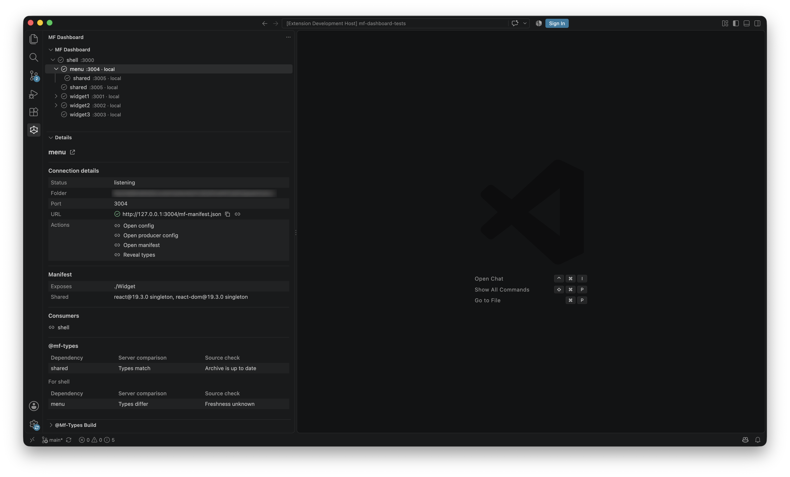

# MF Dashboard

[English](README.md) | [Русский](README.ru.md)

MF Dashboard — расширение VS Code для работы с микрофронтендами на базе Module Federation. В панели MF Dashboard можно следить за состоянием приложений и их remote-зависимостей, запускать локальные приложения, обновлять типы и открывать конфигурации и манифесты.



## Установка

1. `.vsix`: установите из [GitHub Releases](https://github.com/megahoma/mf-dashboard/releases).

## Возможности

1. **Локальный граф** найденных конфигураций микрофронтендов.
2. **Работа с несколькими проектами** в одном окне VS Code.
3. **Дерево или плоский список** микрофронтов. В плоском списке меню **Вид и сортировка** позволяет сортировать по названию или порту. Текущий вариант отмечен галочкой и сохраняется для рабочей области.
4. **Периодическая проверка** портов, манифестов и ZIP-архивов типов.
5. **Проверка доступности** внешних манифестов.
6. **Запуск локальных приложений** через скрипты `package.json`.
7. **Обновление и пересборка типов**: загрузка `@mf-types` потребителей и генерация типов локальных продюсеров.
8. **Навигация из подробностей и контекстного меню** к конфигурациям, каталогу типов и JSON-манифесту.
9. **Диагностика URL и типов в Problems** со ссылками на конфигурацию потребителя или настройки рабочей области.

### Статусы и диагностика

| Статус                | Значение                                                                   |
| --------------------- | -------------------------------------------------------------------------- |
| работает              | Порт локального приложения открыт.                                         |
| остановлен            | Локальный порт закрыт.                                                     |
| порт не определён     | Не удалось определить локальный порт по конфигурации.                      |
| типы не пересобраны   | Исходники продюсера новее ZIP типов, и пауза после сохранения завершилась. |
| типы не обновлены     | Типы потребителя отсутствуют или не соответствуют ZIP remote.              |
| ошибка URL            | URL пуст, содержит неподставленные переменные или не использует HTTP(S).   |
| URL не локальный      | Связь с локальным приложением указывает на другой хост.                    |
| URL на другой порт    | URL связи указывает на другой порт.                                        |
| доступен / недоступен | Внешний манифест ответил или не ответил.                                   |

В дереве видны порт и состояние подключения. При выборе микрофронта содержимое раздела **Подробности** обновляется. Если раздел свёрнут, раскройте его вручную. Там можно проверить доступность манифеста, скопировать его URL и открыть предпросмотр, когда манифест отвечает. В разделе **Потребители** перечислены все найденные микрофронты, которые напрямую подключают выбранный. Нажмите на потребителя, чтобы увидеть его подробности.

Раздел **@mf-types** внизу показывает две проверки для каждой зависимости. **Сравнение с сервером** показывает, совпадают ли установленные типы с ZIP, который отдаёт сервер. **Проверка по исходникам** показывает, актуален ли ZIP относительно локальных исходников. Если локальный микрофронт остановлен, панель предлагает его запустить. При `generateTypes: false` расширение пропускает проверку исходников и пересборку типов этого микрофронта. Типы у потребителя по-прежнему можно проверить, а команда **Загрузить @mf-types** работает и при остановленном потребителе.

Команда **Обновить @mf-types во всём проекте** открывает панель **Сборка @mf-types** и запускает сборку по рабочей области. Кнопка в строке микрофронта подготавливает его зависимости и пересобирает его собственные типы, если генерация включена. Чтобы также установить обновлённые типы у потребителей, используйте команду для всего проекта. Если манифест недоступен, сборка может взять свежий ZIP единственного одноимённого микрофронта в рабочей области. В строках видны ход сборки и ошибки. При сбое независимые проекты продолжают собираться. Команда **Показать результаты последнего обновления @mf-types** открывает последний отчёт по рабочей области.

Проблемы с URL и недоступные внешние манифесты выводятся как предупреждения в панели **Проблемы**. Проблемы с типами выводятся как информация. Туда же попадают ошибки сборки, для которых удалось определить исходный файл.

При `mf-dashboard.types.buildConcurrency` больше `1` независимые микрофронты могут собираться параллельно. Каждое приложение ждёт архивы своих зависимостей. Для пользовательских команд, пересекающихся каталогов приложений и графов с возможной локальной заменой удалённого манифеста сборка идёт последовательно. Генератор с хуком `afterGenerate` или с путями записи, которые не удалось проверить, запускается отдельно от других задач.

Установите `mf-dashboard.types.useBuildCache` в `false`, чтобы встроенный генератор пересобирал типы для всех выбранных приложений, которые их экспортируют. После включения кеша расширение снова использует актуальные архивы, включая собранные при отключённом кеше.

## Обнаружение приложений

Команда **Найти микрофронты** ищет следующие конфигурации:

| Семейство конфигураций | Имя файла                    |
| ---------------------- | ---------------------------- |
| Module Federation      | `module-federation.config.*` |
| Webpack                | `webpack.config.*`           |
| Rspack                 | `rspack.config.*`            |
| Rsbuild                | `rsbuild.config.*`           |
| Rslib                  | `rslib.config.*`             |
| Vite                   | `vite.config.*`              |

Поддерживаемые расширения: `.mjs`, `.cjs`, `.js`, `.mts`, `.cts`, `.ts`, `.jsx` и `.tsx`. Поиск читает исходный текст через Babel, не выполняя конфигурацию. Он распознаёт `pluginModuleFederation`, `ModuleFederationPlugin`, `createModuleFederationConfig`, константы, алиасы, spread объектов, статические выражения и синхронные хелперы со статически определимыми ветками `if` и `switch`. Поддерживаются относительные именованные, default- и namespace-импорты, локальный JSON и реэкспорты в пределах пакета. Версия TypeScript в проекте на поиск не влияет. Асинхронные хелперы, динамические импорты, helper из сторонних пакетов и алиасы tsconfig остаются неразрешёнными.

При разборе функций конфигурации Rsbuild и Vite виджет использует контекст dev-запуска. Он читает литеральные значения переменных из простых команд запуска, в том числе с `cross-env`, и распознаёт `dotenv.parse` для выбранного `.env` в папке конфига.

Для Rslib виджет читает один статически разрешимый профиль `format: 'mf'` с `NODE_ENV=development` по умолчанию. Он извлекает плагин федерации и объединяет нужные настройки профиля с верхнеуровневой конфигурацией. Если в плагине не задан `dts`, типы включаются при наличии `tsconfig.json` в библиотеке. Если скрипт `rslib mf-dev` имеет своё имя, укажите его в `scripts.start`.

При обнаружении через скрипт запуска Rslib виджет читает файлы dotenv из пакета выбранного конфига, если скрипт принадлежит этому пакету или запускает проект внутри своего каталога.
Для чтения dotenv из проверенного каталога конфигурации расширение использует локальный процесс. В Windows он запускается через системный Windows PowerShell. Если системная политика блокирует этот процесс, расширение пропускает соответствующие файлы dotenv.

Простой скрипт запуска может выбрать конфиг через `--config`. Поиск использует `mf-dashboard.scripts.start`, а новые записи приложений наследуют эту настройку. Поле `configFile` задаёт путь относительно папки приложения и имеет приоритет над скриптом.

Локальный порт берётся из `server.port` или `devServer.port`. URL remote могут использовать значения `process.env` или `import.meta.env` из `.env.<mode>` и `.env.<mode>.local`. Приоритет у файла `.local`. Если расширение распознаёт скрипт запуска Vite, значения для `process.env` берутся из явных присваиваний в скрипте. Когда скрипт не задаёт `NODE_ENV`, расширение использует значение по умолчанию для команды Vite. Путь манифеста по умолчанию — `/mf-manifest.json`.

После клонирования один раз запустите **Найти микрофронты**. Команда создаст локальный кэш `.mf-dashboard/graph.json` и добавит правило в `.mf-dashboard/.gitignore`. При повторном открытии панель показывает сохранённое дерево. При включённом опросе статусы обновляются в фоне. Кнопка обновления проверяет статусы по графу. Команда **Найти микрофронты** в заголовке пересоздаёт граф.

В графе хранятся относительные пути, вычисленные URL и контрольные суммы входов, включая локальные dotenv-файлы. После изменения конфига или локального dotenv-файла запустите **Найти микрофронты**, чтобы обновить граф. Явная пересборка типов читает актуальные конфиги и окружение скрипта запуска.

Поиск пропускает `node_modules`, `.git`, `dist`, `.mf-dashboard` и `mf-dashboard.ignorePaths`. Для workspace с несколькими корнями создаётся граф в каждой папке. Имена federation и имена папок workspace должны быть уникальны. При конфликте поиск сохраняет прежний граф.

При `mf-dashboard.probeIntervalMs: 0` сохранение исходников также пропускает автоматическую проверку типов, даже если включён `mf-dashboard.types.autoCheck`.

За один цикл один и тот же манифест или ZIP запрашивается один раз. Следующие циклы используют `If-Modified-Since`, если он доступен, и сохранённые хеши ZIP при ответе 304.

При проверке `@mf-types` расширение сравнивает опубликованный ZIP с типами, установленными Rsbuild в watch-режиме или другим инструментом. Для ручной проверки используйте **Обновить** или **Проверить @mf-types**. Автопроверка запускается при `mf-dashboard.types.autoCheck: true`. Расширение может повторно скачать ZIP при изменении хеша архива или локальных файлов. При совпадении оно сохраняет подтверждение установки. Если архив и файлы типов прежние, расширение использует предыдущий результат. Сравнение выполняется в режиме чтения.

Если автопроверка типов включена, сохранение входящего в проект файла `.ts` или `.tsx` в VS Code обновляет оценку типов сразу и после `typesSettleMs`. При сохранении расширение использует локальные файлы и результаты сравнения архивов, которые уже есть в кэше. Фоновые проверки также учитывают изменения вне редактора. Кэш использует размер и время изменения файла. Если оба значения сохранились, в кэше может остаться предыдущий результат.

Исходники продюсера выбираются по `files`, `include`, `exclude` и унаследованным настройкам указанного tsconfig. Явные `files` учитываются даже при пустом `include`. Декларации, скачанные типы, каталоги сборки, файлы вне приложения и пути через symlink пропускаются. Если tsconfig повреждён или недоступен, свежесть типов остаётся неизвестной.

## Поддерживаемые версии пакетов

| Пакет                               | Версия / область поддержки                  |
| ----------------------------------- | ------------------------------------------- |
| VS Code                             | `^1.90.0`, требование манифеста расширения. |
| `@module-federation/enhanced`       | `2.9.1`                                     |
| `@module-federation/rsbuild-plugin` | `2.9.1`                                     |

Встроенная генерация типов использует API Module Federation из пакетов проекта. Для Rsbuild она загружает конфигурацию и перехватывает параметры плагина. Для Rslib она читает MF-профиль статически и передаёт его настройки тому же генератору. Обнаружение других сборщиков само по себе не гарантирует встроенную генерацию.

Во время работы расширение не проверяет версии по semver-матрице. Совместимость с другими версиями не установлена. Если встроенная генерация не может использовать конфигурацию или API плагина, задайте команду проекта в `mf-dashboard.commands.rebuildTypes`. Сам поиск не требует загрузки этих пакетов.

## Настройки

Все настройки используют пространство имён `mf-dashboard.*`.

| Настройка                             | По умолчанию  | Описание                                                                                                                                                                                                               |
| ------------------------------------- | ------------- | ---------------------------------------------------------------------------------------------------------------------------------------------------------------------------------------------------------------------- |
| `mf-dashboard.envMode`                | `development` | Выбирает `.env.<mode>` и `.env.<mode>.local` при поиске. Режим из распознанного скрипта запуска может иметь приоритет.                                                                                                 |
| `mf-dashboard.structure`              | `tree`        | Вид панели микрофронтов по умолчанию. `tree` показывает дерево, `flat` показывает плоский список.                                                                                                                      |
| `mf-dashboard.types.structure`        | `tree`        | Вид панели сборки по умолчанию. Поддерживаются `tree` и `flat`.                                                                                                                                                        |
| `mf-dashboard.language`               | `auto`        | Язык подписей расширения, подробностей, подсказок кнопок и контекстного меню. `auto` использует язык VS Code. `en` и `ru` задают язык явно.                                                                            |
| `mf-dashboard.ignorePaths`            | `[]`          | Дополнительные исключения поиска. Имя папки совпадает на любой глубине. Относительный путь исключает всё поддерево. Явная запись в `apps` позволяет включить исключённую папку.                                        |
| `mf-dashboard.extraManifestUrls`      | `[]`          | Внешние URL манифестов в корневых строках. Запросы идут только на корректные HTTP(S) адреса.                                                                                                                           |
| `mf-dashboard.packageManager`         | `auto`        | Менеджер для запуска: `auto`, `npm`, `pnpm`, `yarn` или `bun`.                                                                                                                                                         |
| `mf-dashboard.probeIntervalMs`        | `5000`        | Пауза между фоновыми проверками в миллисекундах (минимум `1000`). При `0` статусы проверяются только по команде **Обновить** или **Проверить @mf-types**.                                                              |
| `mf-dashboard.types.buildConcurrency` | `1`           | Максимум одновременных задач сборки @mf-types в одном окне.                                                                                                                                                            |
| `mf-dashboard.types.useBuildCache`    | `true`        | Повторно использовать актуальные архивы при сборке @mf-types встроенным генератором.                                                                                                                                   |
| `mf-dashboard.types.autoCheck`        | `false`       | Включите `true` для автопроверки типов. По умолчанию порты и манифесты обновляются в фоне, а типы проверяются по команде **Обновить** или **Проверить @mf-types**.                                                     |
| `mf-dashboard.typesSettleMs`          | `15000`       | Пауза в миллисекундах после изменения исходников, прежде чем расширение сообщит об устаревших типах. При `0` сообщение выводится сразу.                                                                                |
| `mf-dashboard.terminal.reveal`        | `true`        | Показывает терминал при запуске микрофронта. При `false` скрипт всё равно запускается.                                                                                                                                 |
| `mf-dashboard.scripts.start`          | `dev`         | Ключ скрипта в `package.json`, если у приложения нет своего значения.                                                                                                                                                  |
| `mf-dashboard.commands.rebuildTypes`  | `""`          | Пользовательская команда генерации типов. Пустая строка использует API плагина. Доступны подстановки `{folder}`, `{name}`, `{port}` и `{tsconfig}`.                                                                    |
| `mf-dashboard.commands.refetchTypes`  | `""`          | Пользовательская команда загрузки типов. Пустая строка включает встроенную загрузку. `{typesFolder}` подставляет каталог типов потребителя. Расширение сверяет результат с ZIP и ждёт завершения команды до 60 секунд. |
| `mf-dashboard.apps`                   | отсутствует   | Ручные переопределения для отдельных приложений. Их читает команда **Найти микрофронты**. Граф может заполняться автоматически.                                                                                        |

Выбор вида через панели сохраняется для рабочей области и имеет приоритет над настройкой по умолчанию. После изменения параметров поиска, таких как `envMode`, `ignorePaths`, `scripts.start` или `apps`, повторно запустите **Найти микрофронты**, чтобы обновить граф.

Пример настройки для микрофронта с нестандартным конфигом и ZIP типов.

```json
{
  "mf-dashboard.apps": {
    "shell": {
      "path": "apps/shell",
      "configFile": "build/rsbuild.custom.ts",
      "typesZipPath": "dist/@mf-types.zip",
      "scripts": { "start": "dev" }
    }
  }
}
```

`path` задаётся относительно папки рабочей области. Если папок несколько, `workspaceFolder` выбирает нужную по имени. `configFile` задаётся относительно папки приложения и имеет приоритет над путём из скрипта запуска. `manifestPath` переопределяет найденный маршрут манифеста. `typesZipPath` указывает на ZIP, который создаёт пользовательская команда сборки, относительно папки приложения. Настройка приложения `scripts.start` имеет приоритет над общей.

В `commands.refetchTypes` также можно подставить `{folder}`, `{name}`, `{port}` и `{tsconfig}` потребителя. ZIP из локальной сборки расширение устанавливает напрямую.

При `packageManager: auto` запуск читает корневое поле `packageManager`, затем проверяет `pnpm-lock.yaml`, `yarn.lock`, `bun.lock` / `bun.lockb` и `package-lock.json`. Если ничего не найдено, используется npm. Команда имеет вид `<manager> run <script>`; отсутствующий скрипт или недопустимый ключ не запускает процесс.

## Лицензия

[MIT](LICENSE).
